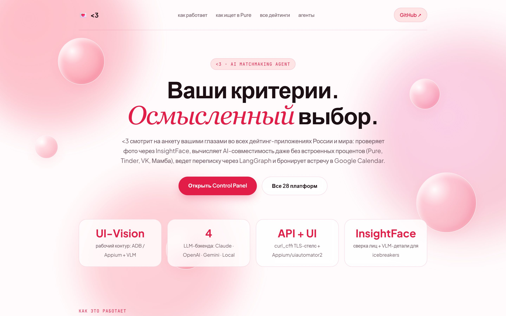

# Heart3

> **Languages:** [English](README.md) · [Русский](README.ru.md)

Local multi-platform dating assistant with screen and browser vision, configurable
scoring, a three-node chat agent, Thompson Sampling bandits, Google Calendar and a
Telegram bot. The full Russian documentation is in [README.ru.md](README.ru.md).

**Site:** https://ssrjkk.github.io/twinby-swipe-bot/  
**Source:** https://github.com/ssrjkk/twinby-swipe-bot

## Screenshot



## Operating modes

- `ui_vision` — Android ADB or Android/iOS Appium; screenshots are analyzed by a VLM.
- `web_vision` — Playwright with a persistent browser profile.
- `api` — experimental declarative REST client generated from a real HAR profile.

The registry contains platform specifications, but live API compatibility is not
guaranteed. API mode requires a verified HAR capture for the target service.

## Quick start

```bash
python -m venv .venv
source .venv/bin/activate
pip install -e ".[test]"

pytest -v
heart3 setup
heart3 doctor
heart3 run
```

On Windows, activate `.venv\Scripts\activate`. If Smart App Control blocks the
generated `heart3.exe`, run the CLI through the virtualenv Python module instead.

Browser mode needs `.[web-browser]` and `playwright install chromium`. The chat agent
needs `.[langgraph]`; Calendar integration needs `.[calendar]`.

## Control panel and security

The service exposes a landing page and `/dashboard` on port 8080. Binding outside
loopback requires `WEB_API_TOKEN`; CORS origins must be explicit. API keys are
masked in responses, and `.env` writes are restricted to the owner.

Telegram mode requires both `TG_BOT_TOKEN` and a positive `TG_ADMIN_ID`.

## Documentation

- [Russian README](README.ru.md)
- [Integration guide](AGENT_INTEGRATION_GUIDE.md)
- [Security policy](SECURITY.md)

## License

MIT — see [LICENSE](LICENSE).
