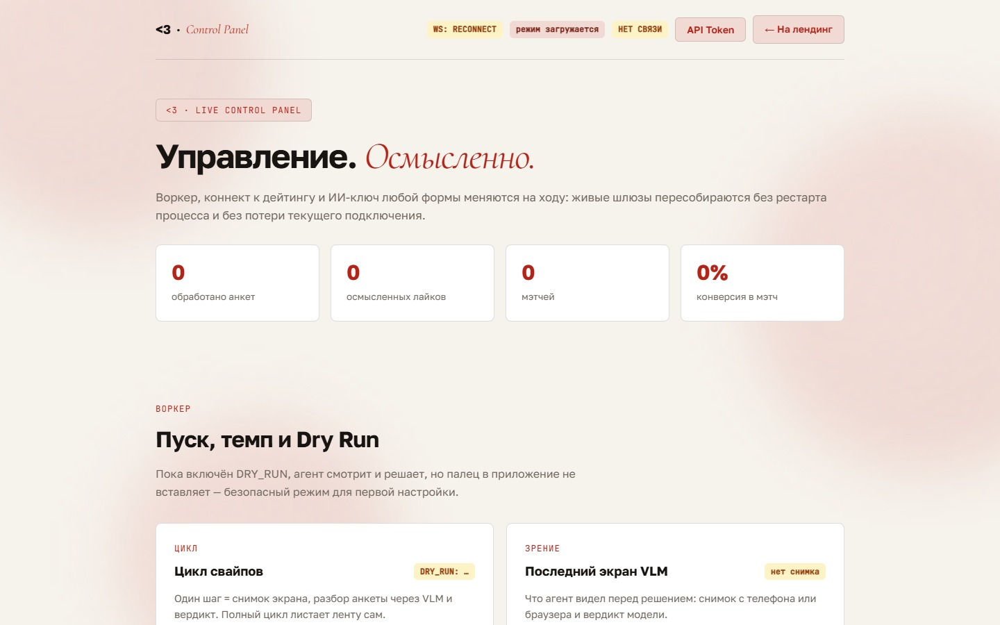
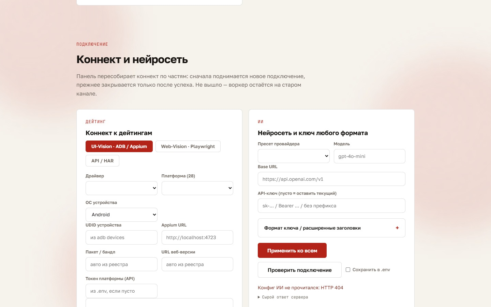

# <3 — AI Matchmaking Agent

[](https://github.com/ssrjkk/twinby-swipe-bot/actions/workflows/ci.yml)

Локальный мультиплатформенный ассистент для дейтинга с визуальным анализом анкет и чатов (VLM-граундинг кнопок), настраиваемым скорингом, 3-узловым чат-агентом (`Profiler → Strategist → Humanizer`), Thompson Sampling бандитами, Web Control Panel (`/dashboard`), Google Calendar и Telegram-ботом.

Лендинг проекта: **https://ssrjkk.github.io/twinby-swipe-bot/**  
Гайд для AI-агента по внедрению в репозиторий: **`AGENT_INTEGRATION_GUIDE.md`**

**CI:** матрица Python `3.10` / `3.11` / `3.12`. **Тесты:** 104 (`pytest`), из них 45 — на чистой стандартной библиотеке (`unittest discover -s tests -p "test_stdlib_*.py"`), проходят без единого внешнего пакета.

## Интерфейс

Снято с реально запущенного сервиса (`heart3 run`, `MODE=web_vision`, `PLATFORM=mamba`, `DRY_RUN=true`, свежая БД), не генерировалось.

Лендинг на `http://127.0.0.1:8080/`:


Control Panel на `http://127.0.0.1:8080/dashboard` — счётчики обнулённой сессии, метка `DRY_RUN` и живой бейдж `WS: LIVE`:



## Три рабочих контура

1. **`MODE=ui_vision` (Android ADB / Android & iOS Appium):**
   Снимает 1–2 экрана карточки, проверяет `FLAG_SECURE`, сжимает скриншот до JPEG, через VLM извлекает поля анкеты и координаты кнопок `like_button` / `pass_button` / `dismiss_button`, автоматически закрывает попапы и нажимает нужную кнопку (или свайпает по кривой Безье).
2. **`MODE=web_vision` (Playwright):**
   Открывает веб-версию выбранной платформы (`PLATFORM=mamba|vk_dating|tinder|bumble|badoo|tabor|...` — URL подбирается автоматически из реестра 28 платформ) с постоянным профилем `./data/browser_profile`.
3. **`MODE=api` (Декларативный HAR-профиль):**
   Выполните `heart3 har-export dump.har --platform twinby`, чтобы из реального `.har` дампа сгенерировать `./data/api_profiles/<uuid>.json` — `DeclarativeRestDatingClient` автоматически подхватит его с ретраями 429/5xx, cookies и авторефрешем токена на 401.

## Control Panel: подключение и ИИ-ключ

Панель `/dashboard` собрана в том же визуальном языке, что и лендинг — та же палитра, те же плавающие пузыри, шрифты и стеклянные карточки; соответствие проверяет `tests/test_stdlib_unified_design.py`.

**«Подключение и платформа»** (`GET`/`POST` `/api/v1/connection`) меняет способ работы на ходу, без перезапуска сервиса:

1. `MODE=ui_vision` + `DEVICE_DRIVER=adb` — телефон по USB;
2. `MODE=ui_vision` + `DEVICE_DRIVER=appium` — Android (UiAutomator2) или iOS (XCUITest);
3. `MODE=web_vision` + `playwright` — веб-версия платформы в постоянном профиле браузера;
4. `MODE=api` + `rest_api` — прямой REST по декларативному профилю.

Платформа выбирается из реестра 28 дейтингов, пакет и URL подставляются из него же (их можно переопределить вручную). Кнопка подключает новое, только когда оно отвечает: старый драйвер закрывается после успешного `connect()`, при неудаче возвращается `502`, а прежнее подключение остаётся рабочим. Загрузка `.har` дампа (`POST /api/v1/connection/har-import`) превращает его в `./data/api_profiles/<uuid>.json` — тем же кодом, что и `heart3 har-export`.

**«нейросеть и ключ любого формата»** (`GET`/`PATCH` `/api/v1/ai/config`) настраивает ИИ без перезапуска: 13 пресетов провайдеров, произвольные `base_url` и модель, ключ в `Authorization` с любым префиксом (в том числе пустым — ключ передаётся как есть), в собственном заголовке (`x-api-key`, `X-Auth-Token`) или в query-параметре. `ollama`, `vllm` и `lmstudio` работают без ключа. Ключ, уже содержащий схему, не получает второй префикс. «Применить ко всем» обновляет все четыре живых шлюза (`worker.vision_parser`, `worker.synthetic_scorer`, чат-агент, `visual_chat`) и настройки процесса; в ответе панели ключ отдаётся только в маске. Флаг «Сохранить в `.env`» точечно дописывает соответствующие строки, не трогая остальные.

Все четыре эндпоинта требуют `X-API-Token` (или `?token=`), если в `.env` задан `WEB_API_TOKEN`.

Поступь панели закрыта с трёх сторон. `WEB_HOST` вне `127.0.0.1`/`localhost`/`::1` без `WEB_API_TOKEN` останавливает запуск с `RuntimeError` — чужие анкеты не уезжают в локальную сеть по невнимательности ([`guard_public_bind`](web/api.py), вызывается из [`main.py`](main.py)). `WEB_CORS_ORIGINS` — явный список origin'ов через запятую (по умолчанию только loopback); wildcard не поддерживается. В HTTP-ответ ошибок попадает только классификация (`RuntimeError, код 401`), а не текст чужого исключения: драйверы и HTTP-клиенты кладут в сообщения абсолютные пути профиля и URL сессионных токенов. Полный traceback пишется в лог `web.api`.



## Быстрый старт

```bash
python -m venv .venv && source .venv/bin/activate     # Windows: .venv\Scripts\activate
pip install -e ".[test]"

pytest -v
python -m unittest discover -s tests -p "test_stdlib_*.py" -v

# Интерактивная настройка .env (любой ИИ-провайдер и формат ключа)
heart3 setup
heart3 doctor          # проверяет конфигурацию и делает реальный запрос к ИИ; exit 1 = ключ не работает

# Проверка устройства / браузера и 1-шаговый тест
heart3 test-device
heart3 step
heart3 chat-step

# Запуск сервиса (лендинг :8080/, Control Panel :8080/dashboard)
heart3 run
```

### Windows

Генерируемый pip лаунчер `heart3.exe` на машинах с Smart App Control может не запускаться (ошибка выполнения неподписного файла). Сам CLI при этом полностью рабочий — вызывайте его через интерпретатор:

```powershell
.\.venv\Scripts\python.exe -m cli setup
.\.venv\Scripts\python.exe -m cli doctor
.\.venv\Scripts\python.exe -m cli run
```

## Что заполнять в `.env`

У всех настроек есть значения по умолчанию ([`config.py`](config.py)), поэтому процесс стартует и с пустым `.env`. Для осмысленного запуска обязательна одна строка — `LLM_API_KEY`; без неё запросы уходят без заголовка авторизации, и `heart3 doctor` это покажет.

Если провайдер отличается от OpenAI, правятся **четыре** строки (`AI_PROVIDER`, `LLM_BASE_URL`, `LLM_MODEL`, `LLM_API_KEY`) — проще один раз запустить `heart3 setup`, он подставит `LLM_BASE_URL` и `LLM_MODEL` из `PROVIDER_PRESETS`. OpenAI-совместимые шлюзы (Groq, OpenRouter, DeepSeek, LM Studio) работают с `AI_PROVIDER=openai` и своим `LLM_BASE_URL`.

Telegram-контур поднимается только парой: `TG_BOT_TOKEN` **и** `TG_ADMIN_ID > 0` — одного токена недостаточно ([`main.py`](main.py)). При старте бот прогружает меню команд (`/start`, `/menu`, `/step`, `/chatstep`, `/slots`, `/book`, `/reply`, `/backup`) отдельно для `ru` и `en` и копией в default-скоуп: клиент показывает скоуп своего языка интерфейса, а без default-скоупа меню пусто у всех, чей язык не совпал ([`register_bot_commands`](bot/telegram.py)).

| Extra | Когда нужен |
|---|---|
| `.[test]` | запуск тестов |
| `.[web-browser]` | `MODE=web_vision` + `playwright install chromium` |
| `.[api]` | `curl_cffi` для `MODE=api` (иначе fallback на `httpx`) |
| `.[langgraph]` | чат-агент `Profiler → Strategist → Humanizer` |
| `.[vision-local]` | `FACE_CHECK_ENABLED=true` (локальная проверка лиц) |
| `.[calendar]` | Google Calendar (`/slots`, `/book`) |

### Какой режим доступен с вашей ОС

- **Windows:** `MODE=web_vision` (браузер) либо `MODE=ui_vision` + `DEVICE_DRIVER=adb` с Android-телефоном или эмулятором.
- **iOS через Appium (`DEVICE_OS=iOS`)** требует macOS и Xcode — напрямую с Windows iPhone не управляется.
- **`MODE=api`** — экспериментальный: эндпоинты нужно сначала сверить по реальному `.har`-дампу (`heart3 har-export`).

Если в оболочке, из которой запускается бот, `NO_PROXY` содержит IPv6-литерал вида `[::1]`, `httpx` падает с `InvalidURL`. В PowerShell достаточно `Remove-Item Env:NO_PROXY -ErrorAction SilentlyContinue`.

## Внедрение в репозиторий `ssrjkk/twinby-swipe-bot`

```bash
# Универсально (Windows / macOS / Linux):
python scripts/sync_to_repo.py --target ./twinby-swipe-bot --clone --commit --push

# Или через shell / PowerShell:
./scripts/apply_to_repo.sh /path/to/twinby-swipe-bot --commit --push
.\scripts\apply_to_repo.ps1 -TargetRepo C:\path\to\twinby-swipe-bot -Commit -Push
```

**Важно:** синк удаляет в цели репозитория всё, чего нет в архиве релиза. Так из репозитория исчезли `LICENSE`, `SECURITY.md`, `CODE_OF_CONDUCT.md`, `CONTRIBUTING.md`, `.github/dependabot.yml` и `.github/workflows/codeql.yml` — их пришлось возвращать отдельным коммитом. Перед боевым прогоном оставьте страховочную ветку (`backup-pre-v39`) и после синка сверяйте `git status`.

## Документация

- [Integration guide](AGENT_INTEGRATION_GUIDE.md)
- [Security](SECURITY.md)
- [Website](https://ssrjkk.github.io/twinby-swipe-bot/)
